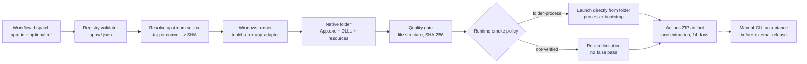
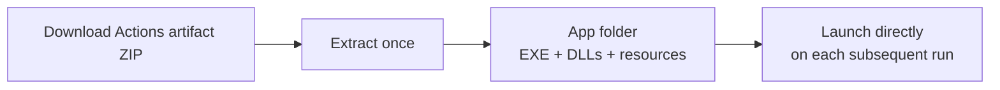

# Portable Factory v1 — Windows x64

Portable Factory is the **reusable CI/CD foundation** for compiling multiple upstream desktop applications into no-install Windows packages. It does **not** promise user-data isolation, signed binaries, or GUI compatibility just because a build succeeds.

## Architecture



Legend: solid lines are executed by CI; the dashed line is a **manual quality gate**, not an automated release. The upstream checkout is a separate trust boundary: its build scripts execute on disposable GitHub-hosted Windows runners with read-only repository permissions and no signing secrets.

## Why folder-first?



Unlike an NSIS `portable` self-extracting EXE, the DLLs and Electron resources stay in the selected folder between launches. This avoids repeated whole-application extraction into `%TEMP%`. Electron's `resources/app.asar` remains a normal archive of application JavaScript/assets; don't extract it independently. **No-install** and **all-data-portable** are different: Windows profiles, credentials, coding agent CLIs and WSL may remain outside the folder.

## How to build any registered app

1. Go to [Actions → Portable Factory - Build App](../../actions/workflows/portable-factory.yml).
2. Choose **Run workflow** on the default branch.
3. Enter `app_id` and optionally `upstream_ref`:
   - `orca` → `stablyai/orca`, default `v1.4.261`
   - `t3code` → `pingdotgg/t3code`, default `v0.1.9`
4. Download `<app_id>-Portable-Windows-x64` and **extract the GitHub Actions ZIP once**. Run the desktop EXE in `<app_id>/` alongside the bundled DLLs and `resources/`. Do not run the EXE from inside the ZIP viewer.

Prefer an exact reviewed commit SHA when reproducibility or supply-chain controls matter. A Git tag may be moved by an upstream maintainer. The resolved commit is always written to `BUILD-INFO.json`.

## Quality contract

| Check | Required | Note |
|---|---|---|
| Registry/schema and ref validation | Yes | Unknown apps/ref injection fail before checkout |
| Pin exact Git commit in provenance | Yes | Source repository, requested ref and resolved SHA |
| Build and native dependency validation | Yes | App-specific adapter |
| Unpacked folder shape, DLLs, resources and minimum size | Yes | Per-app manifest |
| SHA-256 checksum | Yes | `SHA256SUMS.txt` |
| Windows process/boot smoke | Per app | Orca native folder tested; T3 Code explicitly `not-verified` |
| GUI appearance, login and workflows | Manual | CI runner cannot prove these |
| Code signing | Not yet | Artifacts are unsigned |
| GitHub Release publishing | Disabled | Requires explicit review and a separate approval/signing design |

The downloadable artifact itself is the **only ZIP**. After extracting, it has an ordinary directory layout:
```text
portable-artifact.zip             # GitHub Actions download
  (after extracting once)
    orca/
      Orca.exe
      *.dll
      resources/
        app.asar
        ...
    BUILD-INFO.json
    SHA256SUMS.txt               # Checksums for every native app file
    PORTABILITY.txt
```

For T3 Code, the folder is `t3code/` with its upstream desktop executable. There is **no inner ZIP and no self-extracting portable EXE** in the new factory output.

`Orca` and `T3 Code` now both use native-folder packaging. This avoids a self-extracting NSIS portable EXE that can unpack to a temp directory on every launch. It does **not** guarantee that every application starts faster: first-run initialization, disk performance, antivirus scans and external CLIs still matter. Even when CI reports `process-smoke-passed`, this proves only that the unpacked app started as a process and reached the configured bootstrap marker. It does **not** prove an interactive GUI appeared. The app profile and credentials may still use Windows user directories.

## Add another application

1. Create `apps/<id>.json` by copying an existing manifest. Set `id`, `upstream_repo`, `default_ref`, `toolchain`, `formats`, `preferred_format`, `min_size_mb`, `data_portability`, and `smoke`.
2. Add `scripts/portable/apps/<id>.ps1`. The adapter **must accept** `-SourceDir`, `-OutputDir`, `-SourceRef`, `-SourceSha`, and write build packages directly into `OutputDir`. Set `PORTABLE_APP_VERSION=<version>` in `GITHUB_ENV`.
3. Use a supported toolchain (`pnpm-bun-native` or `vite-plus-rust`) or add an explicitly reviewed setup branch in `_portable-windows.yml` and extend `resolve.py`'s `TOOLCHAINS`.
4. Define `smoke.mode`: `folder-process` for a native app directory with a root EXE, or `not-verified` with a clear reason. To test startup logs, supply optional `startup_log_env` and `startup_log_marker`; `env` defines launcher environment variables without hard-coding app logic.
5. Open a PR. `check-portable-factory.yml` checks every manifest, adapter syntax and GitHub Actions YAML. After review, use the new `app_id` through the same manual dispatcher. No new workflow YAML is needed for apps using an existing toolchain.

A typical app manifest:

```json
{
  "id": "example",
  "display_name": "Example",
  "upstream_repo": "example/example",
  "default_ref": "v1.0.0",
  "toolchain": "pnpm-bun-native",
  "target": "windows-x64",
  "formats": ["folder"],
  "preferred_format": "folder",
  "min_size_mb": 1,
  "data_portability": "no-install-only",
  "smoke": {
    "mode": "folder-process",
    "executable": "Example.exe",
    "process_name": "Example.exe",
    "wait_seconds": 20,
    "env": {}
  }
}
```

The example is illustrative: the app adapter must implement its *actual* build system, and a `folder-process` smoke should only be selected when the native app folder really contains the expected root EXE.

## Security and release policy

- GitHub permissions are **read-only** for builds, and checkout does not persist credentials. No release token, publisher token or signing key is passed into an upstream build script.
- The upstream source and its dependencies execute code on the Windows runner. Review new refs, dependency updates and third-party workflow actions before promoting a build. The SHA-256 file is a **consistency check**, not a code signature or supply-chain attestation.
- No automatic upstream tracking and no automatic GitHub Release are enabled. Approve a build manually only after Windows 10/11 GUI checks, malware review, path/credential checks, and any required signatures.
- The factory currently builds **Windows x64**. macOS/Linux, ARM64, signing, reproducible toolchain pinning and automatic release promotion are separate future features.
- Legacy workflows `build-portable.yml`, `build-orca-portable.yml` and `diagnose-orca-portable.yml` remain unchanged during the rollout. Migrate them only after both app adapters pass the new pipeline.
